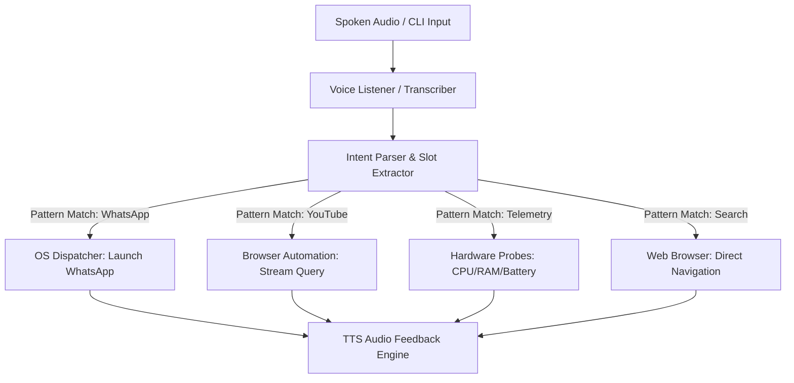

<div align="center">

# Project Jarvis: The Genesis
### Deterministic Voice Assistant & Desktop OS Automation Engine
*Milestone 1 in the Nox Intelligence Evolution (2023 - 2024)*

[](https://www.python.org/)
[](LICENSE)
[](https://github.com/SkMasud18)

</div>

---

## 📜 Architectural Overview

**Project Jarvis** represents the historical foundation of the Nox Intelligence ecosystem. Built as a desktop-native autonomous command system, Jarvis explored the boundary between **offline acoustic speech recognition** and **deterministic operating system action dispatching**.

Before large-language models (LLMs) became the primary interface for cognitive reasoning, Jarvis demonstrated how structured intent classification, regex heuristics, and desktop automation hooks could create an interactive, hands-free personal assistant.



---

## 🚀 Key Features

* **Deterministic Command Execution**: Sub-millisecond intent extraction using pre-compiled pattern matchers and slot extractors.
* **Desktop Application Hooks**: Native system calls to launch apps (WhatsApp, Spotify, Terminals) across macOS, Linux, and Windows.
* **Hardware & Battery Telemetry**: Direct system instrumentation via `psutil` providing real-time CPU, RAM, and power stats.
* **Offline Audio Feedback**: Built-in voice synthesizer providing speech responses without cloud dependency.

---

## 💻 Quick Start

### 1. Installation
```bash
git clone https://github.com/SkMasud18/Jarvis-Voice-Automation.git
cd Jarvis-Voice-Automation
pip install -r requirements.txt
```

### 2. Run Jarvis
```bash
python main.py
```

### 3. Example Directives
* `"open whatsapp"` -> Automates application launch
* `"search on youtube lofi beats"` -> Opens browser with search stream
* `"system status"` -> Reads CPU and RAM health
* `"what time is it"` -> Announces current timestamp

---

## 🔄 Historical Retrospective: From Heuristics to LLMs

While Jarvis offered near-instantaneous execution for known commands, its deterministic design exposed the classic limitation of rule-based systems: **inflexibility when encountering unscripted intents or ambiguous speech**.

This realization led directly to **[Project 2: Nox Core](https://github.com/SkMasud18/Nox-Core-Gemini)**, transitioning from rigid regex rules to neural cognitive reasoning via large language models.

---

<div align="center">
  <sub>Part of the <b>Nox Intelligence</b> Evolution • Designed by <b>Sk Masud Rahaman</b></sub>
</div>
